# GitHub Actions to GCP: Keyless, Gated Model Deployment

Lab: `Labs/Github_Labs/Lab3` from [raminmohammadi/MLOps](https://github.com/raminmohammadi/MLOps/tree/main/Labs/Github_Labs/Lab3) (GitHub Actions and GCP Connections)

This repository trains a classifier in GitHub Actions and deploys it to Google Cloud Storage. The original lab trained a Random Forest on Iris and uploaded every model it produced, authenticating with a downloaded service account key. This version keeps the same idea (GitHub Actions trains a model and stores it in GCS) but rebuilds how GitHub connects to GCP and how a model is allowed to go live.

## Table of contents

1. [What I changed](#1-what-i-changed)
2. [How the pipeline works](#2-how-the-pipeline-works)
3. [Repository layout](#3-repository-layout)
4. [What you need installed](#4-what-you-need-installed)
5. [Part A: Run it on your own machine (no cloud needed)](#5-part-a-run-it-on-your-own-machine-no-cloud-needed)
6. [Part B: Set up GCP with keyless authentication](#6-part-b-set-up-gcp-with-keyless-authentication)
7. [Part C: Connect GitHub and run the pipeline](#7-part-c-connect-github-and-run-the-pipeline)
8. [What a successful run looks like](#8-what-a-successful-run-looks-like)
9. [Results](#9-results)
10. [A bug the pipeline caught](#10-a-bug-the-pipeline-caught)
11. [Notes and limitations](#11-notes-and-limitations)
12. [Troubleshooting](#12-troubleshooting)
13. [Cost and cleanup](#13-cost-and-cleanup)
14. [Screenshots](#14-screenshots)

---

## 1. What I changed

### Core concept: how GitHub Actions connects to GCP and deploys a model

| Area | Original lab | This version |
|---|---|---|
| Authentication | Service account JSON key stored as a GitHub secret (`GCP_SA_KEY`) | **Workload Identity Federation (keyless).** GitHub issues a short-lived OIDC token for each run, GCP exchanges it for temporary credentials. No key exists anywhere. |
| Who can authenticate | Anyone who has the key | Only workflows from this exact repository. GCP checks `assertion.repository == 'elentajacob/mlops-lab4'`. |
| Permissions | `Storage Admin` on the whole project | `Storage Object Admin` on **one bucket only** |
| Configuration | Bucket name hardcoded in the script | GitHub repository **variables** (not secrets, since nothing is sensitive) |
| Pipeline shape | One job: train and upload | Three jobs: **Unit tests** then **Train, gate and upload** then **Verify live model** |
| Deciding what goes live | Every model is uploaded and used | **Quality gate.** A new model replaces the live one only if it meets a minimum accuracy and does not regress against the live model. |
| Storage layout | One timestamped file per run | **Champion/challenger.** Every candidate is kept in `models/runs/` for auditing. Only gate-passing models are copied to `models/latest/`. |
| Deployment check | None | The verify job downloads the live model back from GCS, re-scores it on the same test set and checks it matches what training recorded |
| Traceability | Timestamp only | Each model records its version number, commit SHA, run ID, trigger and hyperparameters |
| Failed uploads | Caught and printed, so the run still passed | Errors are not caught, so a failed upload fails the run |
| Manual runs | Plain "Run workflow" button | Inputs for the model's C value and both gate thresholds, so experiments need no code changes |
| Run hygiene | None | Job summaries on the run page, path filters (README and screenshot pushes do not retrain), concurrency control, timeouts |
| Workflow location | `workflows/run.yaml`, which GitHub never runs | `.github/workflows/train-and-upload.yml` |
| Versions | Unpinned packages, `ubuntu-latest`, Node 20 actions | Pinned packages (including scipy), pinned `ubuntu-24.04` runner, Node 24 action versions |

### Data, model and statistics

| | Original lab | This version |
|---|---|---|
| Dataset | Iris (150 samples, 4 features) | **Wine** (178 samples, 13 chemical measurements, 3 cultivars) |
| Model | RandomForestClassifier | **StandardScaler + LogisticRegression** (C tuned to 0.1) |
| Evaluation | Accuracy only | Accuracy, macro precision, recall and F1, per-class F1, log loss, confusion matrix, 5-fold stratified cross-validation, **bootstrap 95% confidence interval** for test accuracy |
| Dataset statistics | None | Sample and class counts, class balance ratio, missing values, and the ratio between the largest and smallest feature spread (about 2530, which is why the model standardizes features first) |
| Tests | None | 23 tests: data, model, statistics, gate rules, GCS helpers, and the full train, gate, promote and verify flow on an in-memory fake bucket |

---

## 2. How the pipeline works

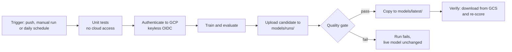

**Triggers**
- **Push** to `main` that changes code, tests, requirements or the workflow
- **Manual run** from the Actions tab, with optional inputs
- **Daily schedule** at 05:00 UTC (midnight in Boston)

**Quality gate.** A candidate goes live only if both rules pass:
1. Test accuracy is at least `min_accuracy` (default 0.90).
2. Macro F1 is no more than `max_regression` (default 0.02) below the live model's macro F1. This rule is skipped for the very first model.

If the gate fails, the candidate is still uploaded to `models/runs/` so it can be inspected later, the run is marked as failed, and the verify job is skipped.

**How keyless authentication works**
1. The train and verify jobs have `id-token: write` permission, which lets them request a signed token from GitHub describing the run, including which repository it came from.
2. GCP's Workload Identity Pool trusts tokens from GitHub, but its provider only accepts tokens whose repository is `elentajacob/mlops-lab4`.
3. That repository is allowed to act as the `gha-trainer` service account, which can only read and write objects in one bucket.
4. The credentials last about an hour and are never stored.

---

## 3. Repository layout

```
.github/workflows/train-and-upload.yml   the three-job pipeline
src/model_pipeline.py                    data, model, statistics, quality gate rules (no cloud code)
src/gcs_utils.py                         upload, download, read metrics, promote to latest
train_and_save_model.py                  entry point: train, evaluate, gate, upload, promote
verify_model.py                          downloads the live model and re-scores it
tests/conftest.py                        in-memory fake GCS bucket used by the tests
tests/test_model_pipeline.py             tests for data, model, statistics and gate rules
tests/test_gcs_and_flow.py               tests for GCS helpers and the full end-to-end flow
requirements.txt                         pinned package versions
screenshots/                             evidence from real runs
```

The first commit in the history is the professor's original Lab3 files, unchanged. Every later commit makes one change.

---

## 4. What you need installed

| Tool | Version used | Needed for | Get it |
|---|---|---|---|
| Git | 2.x (tested with 2.52) | Cloning the repo | https://git-scm.com/downloads |
| Python | 3.10, 3.11 or 3.12 (tested locally with 3.11.6, CI uses 3.12) | Running locally | https://www.python.org/downloads/ (on Windows, tick "Add python.exe to PATH" during install) |
| GitHub account | | Running the pipeline | https://github.com |
| Google Cloud account with billing | Free trial is enough | Part B and C | https://console.cloud.google.com |

You do **not** need to install the Google Cloud SDK. All GCP setup is done in Cloud Shell, which runs in the browser.

Python packages (installed in Part A by `requirements.txt`):

| Package | Version |
|---|---|
| pandas | 2.2.3 |
| numpy | 2.1.3 |
| scikit-learn | 1.5.2 |
| scipy | 1.14.1 |
| joblib | 1.4.2 |
| google-cloud-storage | 2.18.2 |
| pytest | 8.3.3 |

scipy is pinned even though nothing imports it directly. scikit-learn depends on it, and without the pin a fresh install picked scipy 1.17.1, which warns that options used by scikit-learn 1.5.2 will be removed in scipy 1.18. Pinning it stops a future scipy release from breaking the pipeline.

---

## 5. Part A: Run it on your own machine (no cloud needed)

These commands are for **Windows Command Prompt**. macOS and Linux equivalents are given where they differ.

**1. Clone the repository**
```
git clone https://github.com/elentajacob/mlops-lab4.git
cd mlops-lab4
```

**2. Create and activate a virtual environment**
```
python -m venv venv
venv\Scripts\activate
```
macOS or Linux: `python3 -m venv venv` then `source venv/bin/activate`

Your prompt should now start with `(venv)`.

**3. Install the pinned packages**
```
pip install -r requirements.txt
```
This takes a minute or two and ends with `Successfully installed ...`.

**4. Run the tests**
```
python -m pytest tests/ -v
```
Expected: `23 passed`. The tests never contact Google Cloud. GCS is replaced by an in-memory fake bucket.

**5. Train locally**
```
python train_and_save_model.py --local
```
Expected: the dataset statistics and evaluation metrics are printed as JSON, followed by:
```
Quality gate: PASS
 - accuracy 1.0000 >= minimum 0.9000
 - no live model yet, so there is nothing to compare against
Saved model and metrics to ...\mlops-lab4\artifacts
```
The `artifacts` folder now contains `model.joblib` and `metrics.json`. It is ignored by git.

To try other settings, pass them as flags, for example `python train_and_save_model.py --local --c 1.0` (accuracy 0.9722) or `--c 0.001` (accuracy 0.8611, gate FAIL).

---

## 6. Part B: Set up GCP with keyless authentication

You need your own GitHub repository first, because GCP will only trust that one repository. Create an empty public repository on GitHub (no README, .gitignore or license), then point your clone at it:
```
git remote set-url origin https://github.com/YOUR_USERNAME/YOUR_REPO.git
```
Do not push yet. Pushing starts the pipeline, which will fail until GCP is ready.

**1. Create a project.** In https://console.cloud.google.com/projectcreate, give it a name and click Create. Note the **Project ID** and, on the project dashboard, the **Project number**.

**2. Open Cloud Shell.** Click the terminal icon (`>_`) at the top right of the console and click Authorize if asked.

**3. Set variables.** Replace the four values on the first lines with your own, then paste the whole block:
```
PROJECT_ID=your-project-id
PROJECT_NUMBER=your-project-number
REPO=YOUR_USERNAME/YOUR_REPO
BUCKET=a-globally-unique-bucket-name
SA_NAME=gha-trainer
SA_EMAIL=$SA_NAME@$PROJECT_ID.iam.gserviceaccount.com
REGION=us-east4
gcloud config set project $PROJECT_ID
```
If Cloud Shell disconnects, paste this block again before continuing.

**4. Check billing is enabled**
```
gcloud billing projects describe $PROJECT_ID
```
Expected: `billingEnabled: true`

**5. Enable the APIs**
```
gcloud services enable storage.googleapis.com iam.googleapis.com iamcredentials.googleapis.com sts.googleapis.com
```

**6. Create the bucket**
```
gcloud storage buckets create gs://$BUCKET --location=$REGION --uniform-bucket-level-access
```

**7. Create the service account and give it access to this bucket only**
```
gcloud iam service-accounts create $SA_NAME --display-name="GitHub Actions trainer"
gcloud storage buckets add-iam-policy-binding gs://$BUCKET --member="serviceAccount:$SA_EMAIL" --role="roles/storage.objectAdmin"
```

**8. Create the Workload Identity Pool and GitHub provider**
```
gcloud iam workload-identity-pools create github-pool --location=global --display-name="GitHub Actions pool"

gcloud iam workload-identity-pools providers create-oidc github-provider --location=global --workload-identity-pool=github-pool --display-name="GitHub provider" --issuer-uri="https://token.actions.githubusercontent.com" --attribute-mapping="google.subject=assertion.sub,attribute.repository=assertion.repository" --attribute-condition="assertion.repository=='$REPO'"
```

**9. Allow your repository to act as the service account**
```
gcloud iam service-accounts add-iam-policy-binding $SA_EMAIL --role="roles/iam.workloadIdentityUser" --member="principalSet://iam.googleapis.com/projects/$PROJECT_NUMBER/locations/global/workloadIdentityPools/github-pool/attribute.repository/$REPO"
```

**10. Print the three values GitHub needs**
```
echo "GCP_WIF_PROVIDER = projects/$PROJECT_NUMBER/locations/global/workloadIdentityPools/github-pool/providers/github-provider"; echo "GCP_SERVICE_ACCOUNT = $SA_EMAIL"; echo "GCS_BUCKET_NAME = $BUCKET"
```

---

## 7. Part C: Connect GitHub and run the pipeline

**1. Add repository variables.** In your repository go to **Settings > Secrets and variables > Actions**, open the **Variables** tab (not Secrets), and add the three values from step 10 with **New repository variable**:

| Name | Example value |
|---|---|
| `GCP_WIF_PROVIDER` | `projects/546414377651/locations/global/workloadIdentityPools/github-pool/providers/github-provider` |
| `GCP_SERVICE_ACCOUNT` | `gha-trainer@mlops-lab4-514822.iam.gserviceaccount.com` |
| `GCS_BUCKET_NAME` | `elenta-mlops-lab4-514822` |

No secrets are needed.

**2. Push**
```
git push -u origin main
```
This starts the first run. Open the **Actions** tab to watch it.

**3. Manual runs with different settings.** In the Actions tab, click **Train, gate and deploy model to GCS** in the left sidebar, then **Run workflow**. You can change:

| Input | Default | Meaning |
|---|---|---|
| Logistic regression C | 0.1 | Inverse regularization strength. Smaller means a simpler model. |
| Minimum test accuracy | 0.90 | Gate rule 1 |
| Largest allowed macro-F1 drop | 0.02 | Gate rule 2 |

---

## 8. What a successful run looks like

**On GitHub**, a promoted run shows all three jobs green (screenshot 12). The run page has two summaries:
- **Training run:** the decision (`PROMOTED to models/latest`), version, C, commit and trigger, a metrics table comparing this run with the live model before it, the bootstrap confidence interval, each gate check with its result, and the folder the candidate was uploaded to.
- **Deployment check:** the live version was downloaded from GCS and re-scored, its accuracy matches training, and three sample predictions are listed.

A **rejected** run is also a correct outcome. It shows Unit tests green, Train red with `REJECTED, live model unchanged` and the failing rule in the summary, and Verify skipped (screenshots 09 to 11).

**In Cloud Storage**, the bucket contains:
```
models/latest/model.joblib       the live model
models/latest/metrics.json       its metrics, gate result and provenance
models/runs/<time>-run<id>/      one folder per training run, promoted or not
```

The version number in a summary is the version a candidate would get if promoted. A rejected candidate shows the next number, but the live version does not change.

---

## 9. Results

Six runs were made on GitHub Actions to exercise every path through the pipeline:

| Run | Trigger | C | Test accuracy | Macro F1 | Outcome |
|---|---|---|---|---|---|
| 1 | push | 1.0 | 0.9722 | 0.9710 | Promoted as version 1 (first model) |
| 2 | manual | 0.1 | 1.0000 | 1.0000 | Promoted as version 2 (better than live) |
| 3 | manual | 0.001 | | | Unit tests failed: a real bug, see section 10 |
| 4 | push | 1.0 | 0.9722 | 0.9710 | Rejected: macro F1 dropped 0.029 below live (limit 0.02) |
| 5 | manual | 0.001 | 0.8611 | 0.8517 | Rejected: below minimum accuracy, and F1 regression |
| 6 | push | 0.1 | 1.0000 | 1.0000 | Promoted as version 3 (C=0.1 made the default) |

`models/runs/` contains five folders, one for every run that trained. Run 3 stopped at the tests, so it never uploaded anything.

After runs 2 and 4 showed C=0.1 beats the original C=1.0, C=0.1 became the default (commit "Make C=0.1 the default after tuning runs"). Without that change, every daily scheduled run would have trained with C=1.0 and been rejected against the better live model.

**Confidence intervals.** The test set has only 36 samples, so the bootstrap interval matters more than the single accuracy number. For C=1.0 the 95% interval is 0.9167 to 1.0000, so its 97.2% accuracy is consistent with anything from about 92% upward. For C=0.001 the interval is 0.7500 to 0.9722. Its upper end is below the live model's accuracy, so that model is worse even under the most favourable reading of the test results, not just unlucky.

---

## 10. A bug the pipeline caught

The first rejection demo (run 3, C=0.001) failed in the wrong place: **Unit tests** failed before training started.

**Cause.** The run settings (`MODEL_C`, `MIN_ACCURACY`, `MAX_REGRESSION`) were defined in the workflow's top-level `env`, so they were set in **every** job, including the test job. Some tests run the full training flow and expect the default model to pass the gate. With `MODEL_C=0.001` in the environment, those tests trained the bad model and failed. Setting `MODEL_C=0.001` locally reproduced the same three failures.

**Fix, in two commits:**
1. The settings were moved from the workflow level to the env of the single training step, so they cannot reach other jobs.
2. A pytest fixture now clears those variables before every test, so the tests give the same result whatever environment runs them.

Run 4 confirmed the fix: tests passed and the gate rejected the model as intended.

---

## 11. Notes and limitations

- **Accuracy is not everything.** C=0.1 scored 100% accuracy, but its log loss (0.1411) is worse than C=1.0 (0.0738) and its cross-validation accuracy is slightly lower (0.9722 vs 0.9791). Stronger regularization makes the model correct but less confident. The gate only checks accuracy and macro F1, so it promoted C=0.1. A stricter gate could also check log loss or cross-validation accuracy.
- **Small test set.** 36 test samples means one misclassification moves accuracy by 2.8 percentage points. This is why the summary reports a confidence interval.
- **The data never changes.** Wine is a fixed dataset, so the daily scheduled run retrains the same model. In a real system the schedule would pick up new data.
- **Bucket-level permissions only.** The service account can read and write any object in its bucket, including `models/latest/`. Stricter setups would separate the account that uploads candidates from the account that promotes them.

---

## 12. Troubleshooting

| Problem | Cause and fix |
|---|---|
| `ModuleNotFoundError: No module named 'src'` | Run commands from the repository root, and run tests with `python -m pytest`, not `pytest`. |
| `GCS_BUCKET_NAME is not set` when running locally | Add `--local` to run without GCP. |
| Auth step fails with `unauthorized_client` or `attribute condition` | The repository name in the provider condition does not match. It is case-sensitive and must be `owner/repo`. |
| Auth step fails with `Permission 'iam.serviceAccounts.getAccessToken' denied` | Step 9 of Part B is missing, or the project number in it is wrong. |
| `403` when uploading | The bucket binding in step 7 of Part B is missing, or `GCS_BUCKET_NAME` points at another bucket. |
| Auth step complains that `workload_identity_provider` is empty | The repository variables are missing or were added under Secrets instead of Variables. |
| Workflow does not start after a push | Only pushes that change code, tests, requirements or the workflow start it. Use **Run workflow** instead. |
| Train job is red with `REJECTED` | That is the quality gate working. Read the gate checks in the run summary. |

---

## 13. Cost and cleanup

A run uses well under a cent of storage, so the free trial covers this easily.

The daily schedule keeps running until you stop it. When you are finished:
1. **Stop the schedule:** Actions tab, select the workflow, click the `...` menu, then **Disable workflow**.
2. **Delete the GCP project:** IAM & Admin > Settings > **Shut down**. This removes the bucket, service account and identity pool together.

---

## 14. Screenshots

| | |
|---|---|
| Local training run (taken before C=0.1 became the default, so it shows C=1.0 results) | 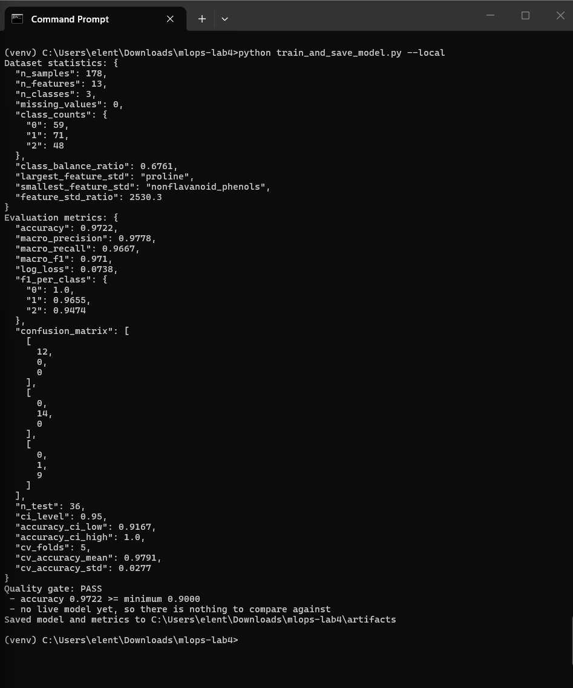 |
| Repository variables (no secrets) | 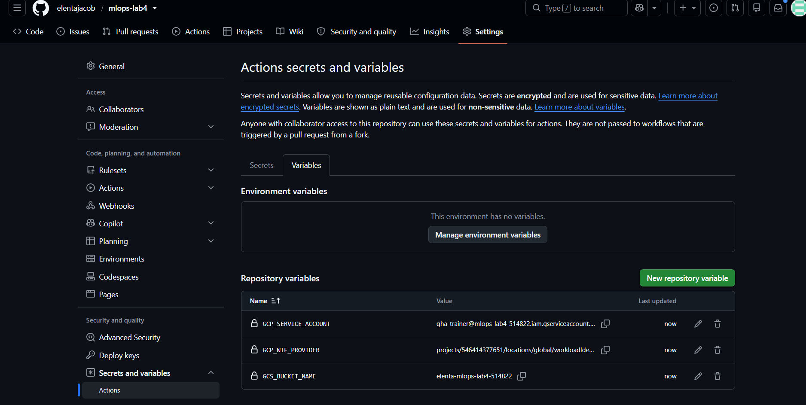 |
| First pipeline run, all jobs green | 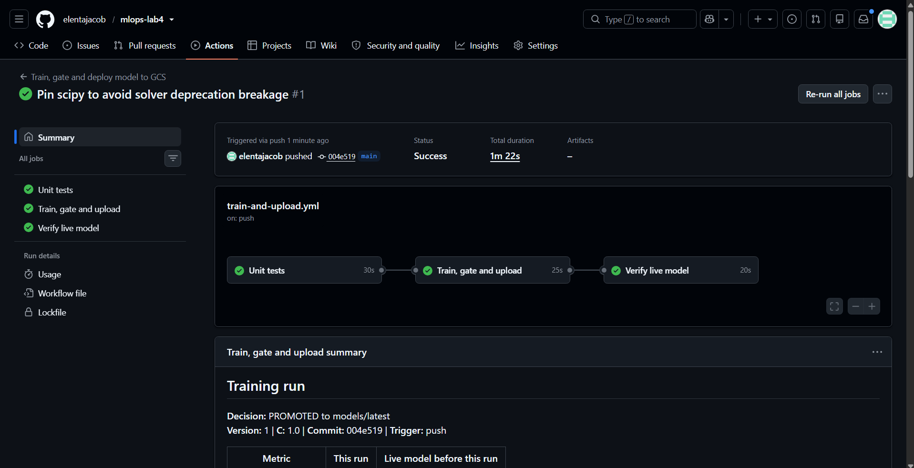 |
| First run summary and deployment check | 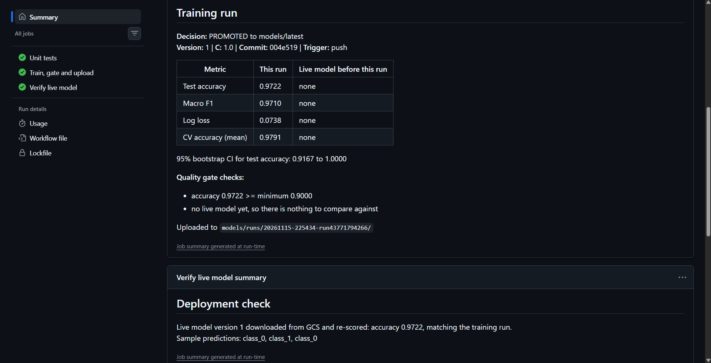 |
| Manual run inputs | 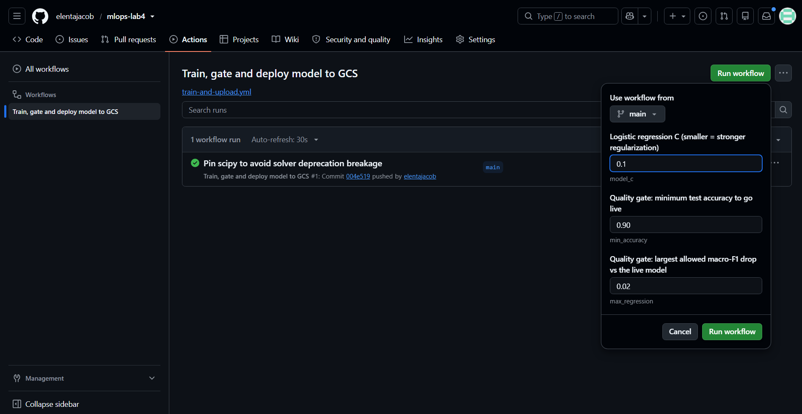 |
| Better model promoted as version 2 | 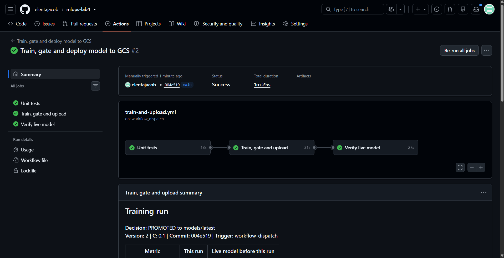 |
| Version 2 summary compared with version 1 | 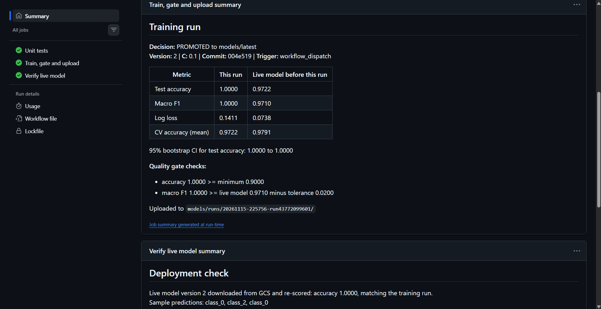 |
| Bug: run settings leaked into the test job | 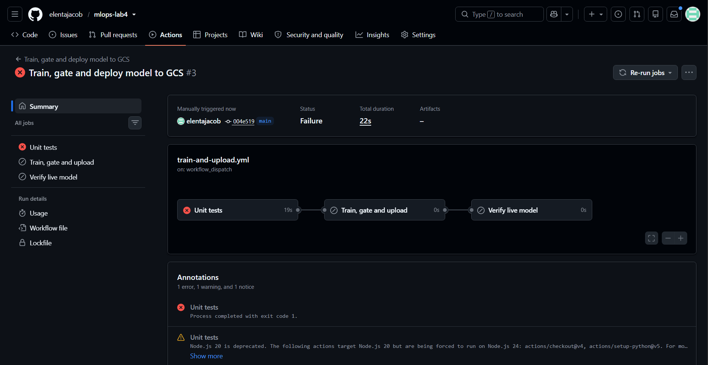 |
| Rejected for F1 regression | 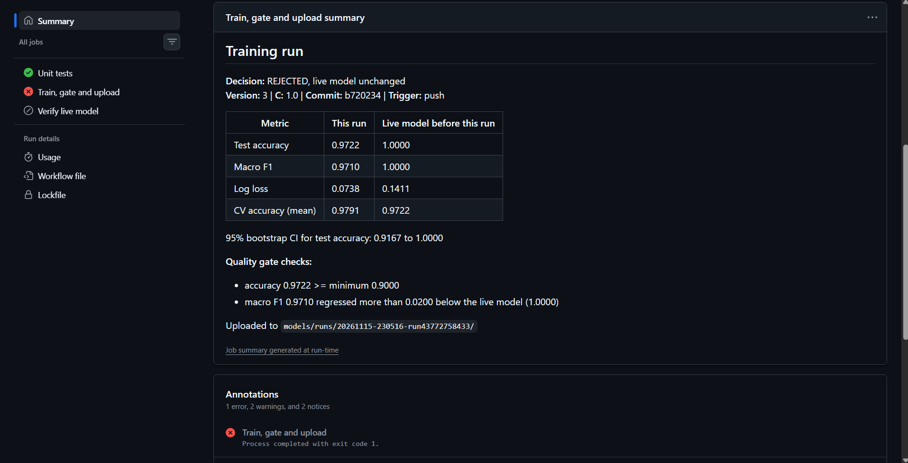 |
| Rejected below minimum accuracy | 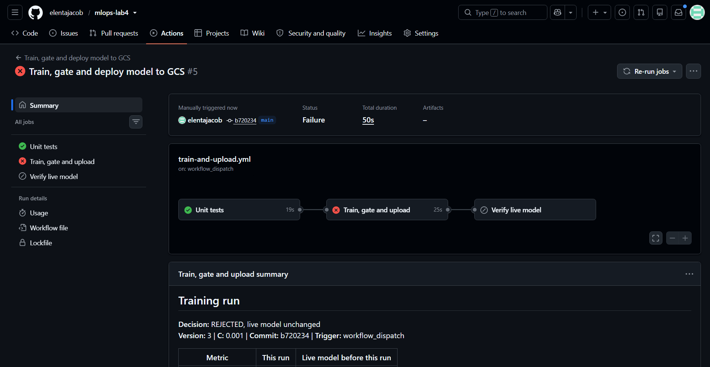 |
| Below-minimum rejection summary | 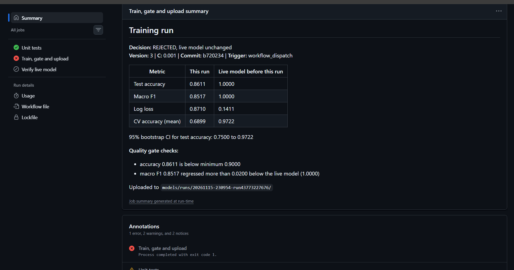 |
| Final run: version 3 promoted, no warnings | 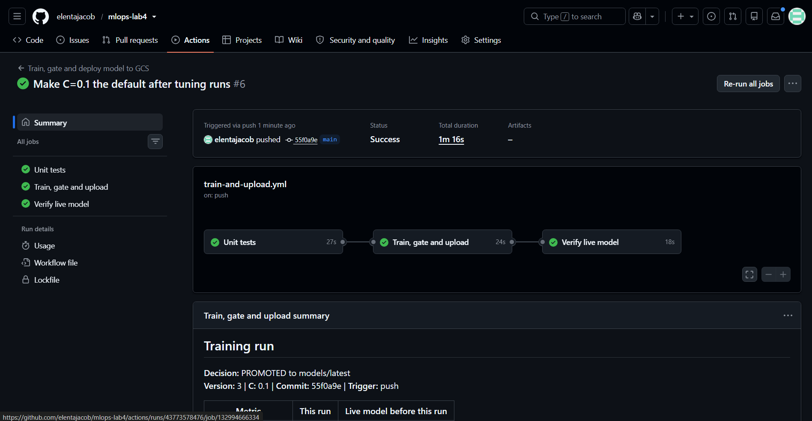 |
| Bucket layout | 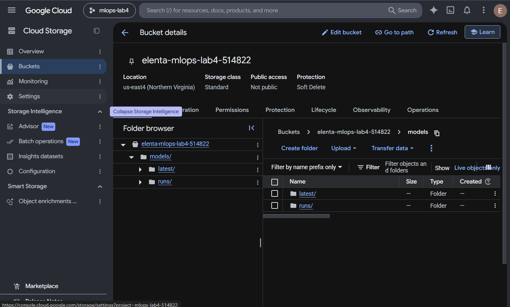 |
| Every training run kept for auditing | 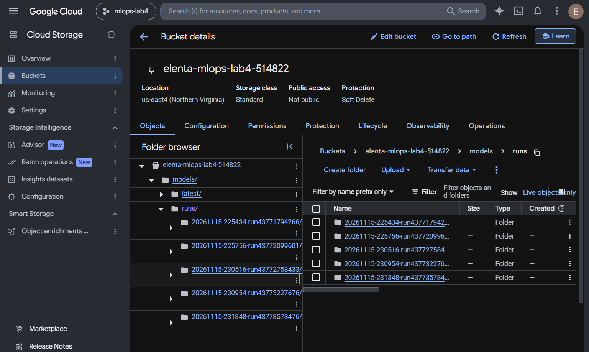 |
